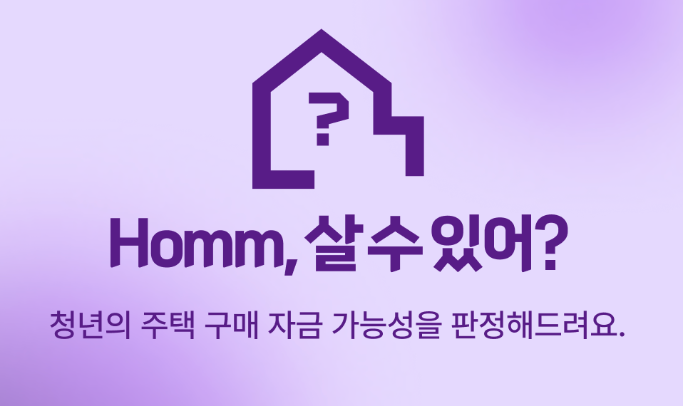
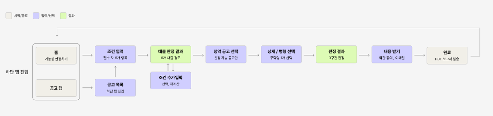
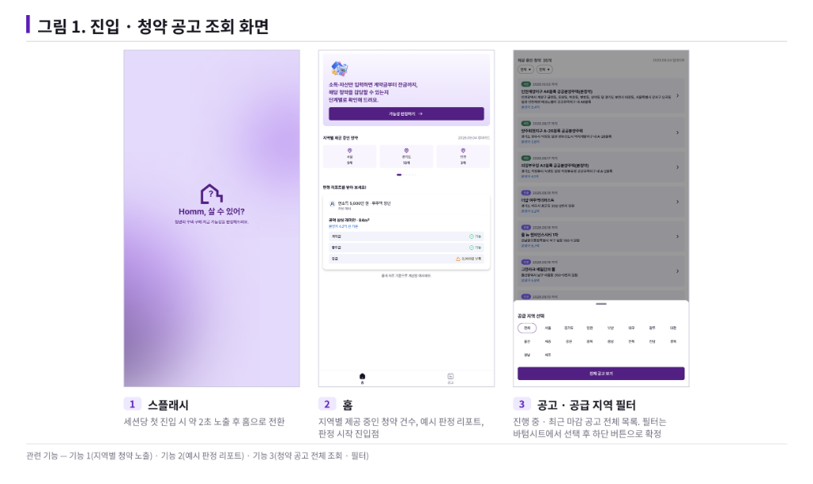
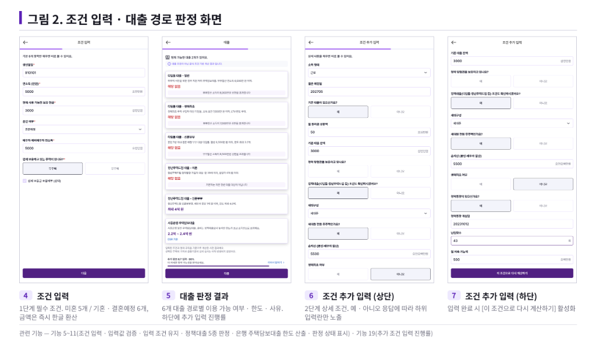
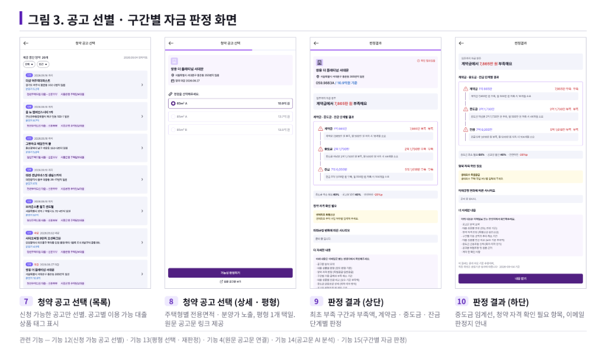
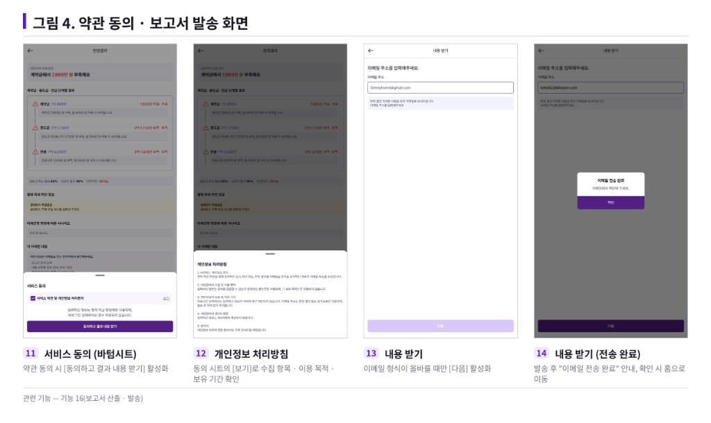
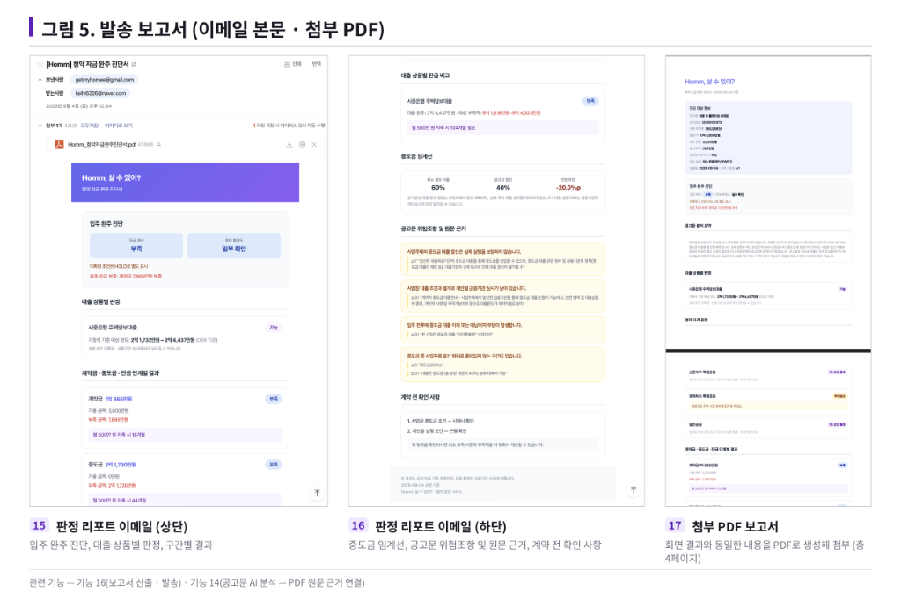

<p align="center">
  
</p>

<h1 align="center">Homm, 살 수 있어?</h1>

<p align="center">
  <b>청약 자금 완주 진단 서비스</b><br />
  청약에 당첨되면 계약금부터 잔금까지 정말 다 낼 수 있는지, 신청 전에 미리 확인해 드려요.
</p>

<p align="center">
  2026 금융 AI Challenge · 팀 GetMyHome
</p>

<p align="center">
  🔗 <a href="https://homm-canibuy.vercel.app/"><b>homm-canibuy.vercel.app</b></a>
</p>

> [!NOTE]
> 현재 백엔드 서버가 운영되지 않아 공고 조회, 대출 판정, 자금 판정, 보고서 발송이 동작하지 않습니다. 서비스가 어떻게 동작하는지는 아래 [화면 둘러보기](#화면-둘러보기)에서 확인할 수 있어요.

---

> **중도금 60%는 대출 60%가 아닙니다.**
> Homm은 청약 *당첨 가능성*이 아니라, 당첨 **이후** 계약금 → 중도금 → 잔금까지 대금을 끝까지 낼 수 있는지(입주 완주 가능성)를 진단합니다.

> 이름의 'Homm'은 '흠(Hmm)'과 '홈(Home)'을 겹친 말이에요. "흠, 이 집 살 수 있을까?"라는 뜻입니다.

## 목차

- [왜 만들었나](#왜-만들었나)
- [무엇을 알려주나](#무엇을-알려주나)
- [이용 흐름](#이용-흐름)
- [화면 둘러보기](#화면-둘러보기)
- [AI는 어디까지 쓰나](#ai는-어디까지-쓰나)
- [개인정보 처리](#개인정보-처리)
- [이 저장소 (프론트엔드)](#이-저장소-프론트엔드)
- [MVP 범위와 한계](#mvp-범위와-한계)

## 왜 만들었나

청약홈에서는 분양가와 청약 일정을, 은행 앱에서는 예상 대출한도를 볼 수 있습니다. 그런데 청약을 준비하는 사람이 정말 알고 싶은 건 따로 있습니다.

> **"이 청약에 당첨되면 계약금부터 잔금까지 실제로 낼 수 있을까?"**

이 질문에 답하려면 흩어져 있는 정보를 직접 이어 붙여야 합니다.

- 청약홈의 단지 · 주택형 · 분양가 · 일정
- 수십 페이지짜리 **입주자모집공고문**에만 적힌 계약금 · 중도금 · 잔금 납부 조건
- 내 소득, 보유 현금, 기존 대출
- 정책대출 · 은행 주택담보대출의 자격과 한도

여기서 가장 흔하게 생기는 오해가 있습니다. 공고문에 적힌 **"중도금 60%"는 개인에게 승인된 "대출 60%"가 아닙니다.** 중도금을 분양가의 60%만큼 내야 해도, 사업주체가 알선하는 중도금 대출은 40%까지만일 수 있습니다. 그러면 나머지 20%는 스스로 마련해야 합니다.

팀이 확보한 실제 입주자모집공고문 33건을 페이지 단위로 대조해 보니, **9건(27.3%)** 은 공고문의 중도금 비율을 대출 가능 비율로 그대로 쓸 수 없었습니다.

| 사례 | 건수 |
| --- | --- |
| 사업주체 대출 알선 상한이 중도금 납부비율보다 20%p 낮음 | 6건 |
| 공고문에서 대출 알선 상한을 확인할 수 없음 | 2건 |
| 중도금 대출 자체가 불가 | 1건 |

<sub>※ 팀이 보유한 표본을 분석한 결과이며, 전체 청약시장의 비율을 뜻하지는 않습니다.</sub>

이 차이를 모르고 계약하면 중도금이나 잔금 단계에서 돈이 모자라 입주하지 못하는 상황이 생길 수 있습니다.

## 무엇을 알려주나

Homm은 내 금융 조건과 **실제 공고문의 납부 조건**을 합쳐 계산합니다. 그래서 돈이 *언제, 왜, 얼마나* 부족해지는지 보여줄 수 있습니다.

| 구간 | 납부 시점 | 마련 방법 |
| --- | --- | --- |
| 계약금 | 당첨 직후 | 보유 현금 (대출 불가) |
| 중도금 | 입주 전 2~3년에 걸쳐 나눠 냄 | 중도금 대출 |
| 잔금 | 입주 시점 | 중도금 대출을 주택담보대출로 전환 |

### 1. 처음으로 돈이 모자라는 구간

"총자금이 부족합니다"로 끝내지 않습니다. 계약금 · 중도금 · 잔금 가운데 **처음으로 돈이 모자라는 구간**과 그 부족액을 결과 맨 위에 보여줍니다. 그 시점에 필요한 금액, 쓸 수 있는 금액, 계산에 쓴 근거도 함께 보여줍니다.

### 2. 중도금 임계선과 조건부 안전마진

중도금 구간을 다 통과하려면 대출이 최소 몇 % 필요한지 계산해, 공고문에 적힌 사업주체 알선 상한과 비교합니다.

```
조건부 안전마진 = 공고문상 사업주체 알선 상한 − 내게 필요한 최소 대출비율
                = 40% − 52%
                = −12%p   → 공고문의 알선 범위만으로는 중도금 구간을 넘기 어렵습니다
```

<sub>※ 알선 상한은 개인에게 승인된 대출비율이 아닙니다. 실제로 받을 수 있는 비율과 한도는 금융기관 심사로 확인해야 합니다.</sub>

### 3. '돈이 부족한 것'과 '정보가 부족한 것'을 따로 보여줌

| 상황 | 자금 상태 | 정보 확정도 |
| --- | --- | --- |
| 돈은 충분하지만 대출 조건이 아직 정해지지 않음 | 충족 | 확인 필요 |
| 대출 조건은 확인됐지만 돈이 부족함 | 부족 | 확인 완료 |
| 돈도 부족하고 일부 조건도 정해지지 않음 | 부족 | 일부 확인 |

그래서 사용자는 *내 조건을 바꿔야 하는지*, *정보를 더 알아봐야 하는지* 구분할 수 있습니다.

### 4. 은행 · 시행사에 바로 물어볼 수 있는 질문

정보가 부족하면 "확인 필요"라고만 하지 않고, 내 상황에 맞춘 구체적인 질문을 만들어 줍니다.

- ❌ "중도금 대출 되나요?"
- ✅ "제 자금 흐름으로는 중도금 대출이 최소 52% 필요한데, 실제로 받을 수 있는 비율과 한도는 얼마인가요?"
- ✅ "사업주체 알선 범위 밖 금액은 몇 회차에 얼마씩 준비해야 하나요?"

### 5. 확인할 수 없으면 판정하지 않음 (HOLD)

공고문에 없는 값을 추측해서 채우지 않습니다. 필요한 정보가 없거나, 문서 안에서 내용이 서로 맞지 않거나, 사람이 아직 검수하지 않았다면 그 구간은 **HOLD(판정 보류)** 로 표시합니다. 보류한 이유와 다음에 무엇을 확인하면 되는지도 함께 알려줍니다.

### 6. 청약 자금 완주 진단서

최종 결과를 은행 상담에 들고 갈 수 있는 **PDF 진단서**로 만들어 이메일로 보내 드립니다. 진단서에는 납부 구조, 알선 상한, 위험 조항과 공고문 원문 근거, 확인할 질문, 계산에 적용한 금융 규칙과 기준일이 들어갑니다.

## 이용 흐름

<p align="center">
  
</p>

회원가입이나 로그인 없이 바로 시작할 수 있습니다.

1. **조건 입력**: 생년월일, 연소득, 보유 현금, 혼인 여부, 주택 보유 여부. 미혼이면 5개, 기혼·결혼예정이면 배우자 소득까지 6개 항목이에요.
2. **대출 판정 결과**: 정책대출 5종(디딤돌 일반 · 생애최초 · 신혼·2자녀, 청년주택드림 미혼 · 신혼)과 은행 주택담보대출을 판정합니다. 상품마다 *이용 가능 / 이용 불가 / 확인 필요*와 그 이유를 보여줍니다.
3. **조건 추가 입력 (선택)**: 소득 형태, 기존 대출, 청약통장, 월 저축 가능액 등을 더 입력하면 결과가 정확해집니다. 건너뛰어도 됩니다.
4. **청약 공고 선택**: 내 예산 범위에 들어오는 공고만 보여주고, 공고마다 어떤 대출 상품으로 가능한지 태그로 표시합니다.
5. **평형 선택**: 고른 주택형의 분양가와 전용면적을 반영해 대출 한도를 다시 계산합니다.
6. **판정 결과**: AI가 공고문을 분석한 결과로 계약금 · 중도금 · 잔금을 구간별로 판정합니다.
7. **내용 받기**: 약관에 동의하고 이메일 주소를 입력하면 PDF 진단서를 보내 드립니다.

공고 탭에서 공고를 먼저 둘러보고 판정을 시작할 수도 있습니다.

## 화면 둘러보기

### 진입 · 청약 공고 조회



### 조건 입력 · 대출 경로 판정



### 공고 선별 · 구간별 자금 판정



### 약관 동의 · 보고서 발송



### 발송되는 보고서 (이메일 본문 · 첨부 PDF)



## AI는 어디까지 쓰나

> **AI는 공고문을 읽고, 계산은 규칙 엔진이 하며, 확인할 수 없는 것은 판단하지 않고 멈춥니다.**

| 생성형 AI가 맡는 일 | 백엔드 규칙 엔진이 맡는 일 |
| --- | --- |
| 형식이 제각각인 입주자모집공고문 읽기 | 정책대출 자격과 예상 한도 |
| 납부 조건 · 금융 조건을 데이터로 정리 | 은행 주택담보대출 예상 한도 (LTV · DSR · DTI) |
| 위험 조항 · 예외 문장 찾기 | 구간별 필요액 · 가용액 · 부족액 |
| 추출한 값마다 PDF 페이지와 원문 근거 연결 | 처음으로 돈이 모자라는 구간과 부족액 |
| 빠진 정보와 문서 안의 충돌 찾기 | 중도금 최소 필요비율과 조건부 안전마진 |

- AI는 대출 승인 가능성을 예측하거나 금융상품을 추천하지 **않습니다**.
- 같은 입력이면 항상 같은 결과가 나오도록, 금액 계산은 전부 정해진 수식으로 합니다.
- AI가 자동으로 뽑은 값(`AUTO_EXTRACTED`)은 바로 판정에 쓰지 않습니다. 아래 조건을 **모두** 만족한 결과만 자금 판정에 씁니다.

  ```
  review_status = REVIEWED             -- 사람이 원문과 대조해 검수함
  AND validation.passed = true         -- 비율·금액·날짜 자동 검증 통과
  AND PDF SHA-256 · 공고번호 · 주택형 · 분양가 · 분석 버전 일치
  ```

- AI 서버가 실패해도 서비스 전체가 멈추지 않습니다. 공고문 없이 할 수 있는 대출 자격 · 한도 판정은 계속 보여주고, 공고문이 필요한 구간만 HOLD로 둡니다.

### 검증 결과 (고정된 범위 기준)

| 항목 | 결과 |
| --- | --- |
| 핵심 필드 추출 재현 | 참조 라벨 260개 중 260개 일치 |
| 공고문에 없는 값 처리 | 4건 모두 값을 지어내지 않고 HOLD 처리 |
| 위험 조항 · 상환 조건 규칙 | 189개 중 189개 일치 |
| 원문 근거 | 위험 조항 근거 89/89, 상환 조건 근거 51/51 일치 |
| 운영 검수본 | PDF 26개, 주택형 · 분양가 조합 154개 등록 (이 중 141개 계산 가능) |

<sub>※ 미리 정해 둔 핵심 필드와 규칙에 한정한 결과입니다. 모든 공고문의 모든 정보를 같은 수준으로 정확하게 추출한다는 뜻은 아닙니다.</sub>

## 개인정보 처리

- 공고문 분석 AI에는 **공개된 공고문과 선택한 주택형 정보만** 보냅니다. 이름, 이메일, 생년월일, 소득, 부채는 보내지 않습니다.
- 입력한 조건은 **브라우저 세션에만** 저장되고, 브라우저를 닫으면 사라집니다. 회원 데이터베이스는 없습니다.
- 백엔드의 조건 토큰과 판정 결과는 메모리에 30분 동안만 보관한 뒤 만료됩니다.
- 공고문과 사용자 금융 조건은 외부 생성형 AI 서비스나 모델 학습에 쓰지 않습니다.

---

## 이 저장소 (프론트엔드)

이 저장소는 Homm의 **모바일 웹 프론트엔드**입니다. 대출 판정, 공고문 AI 분석, 자금 판정, PDF 생성 · 발송은 백엔드와 AI 서버가 맡습니다.

### 기술 스택

- **Next.js 16** (App Router) · **React 19** · **TypeScript**
- **Tailwind CSS v4**: 디자인 토큰은 [src/styles/globals.css](src/styles/globals.css)에 모여 있습니다
- **TanStack Query v5**: 서버 데이터 캐시 · 재검증
- **axios** · **SVGR** (SVG를 React 컴포넌트로 import) · **Pretendard** 폰트
- 패키지 매니저: **pnpm** (`packageManager` 필드로 버전 고정)

### 시작하기

```bash
# 1. 의존성 설치 (pnpm만 사용합니다)
pnpm install

# 2. 환경변수 설정
echo "BACKEND_API_ORIGIN=<백엔드 주소>" > .env.local

# 3. 개발 서버 실행 → http://localhost:3000
pnpm dev
```

| 환경변수 | 설명 |
| --- | --- |
| `BACKEND_API_ORIGIN` | 백엔드 API 주소. 브라우저의 `/api/proxy/*` 요청을 서버에서 `${BACKEND_API_ORIGIN}/api/v1/*`로 넘깁니다. 백엔드가 HTTP라서 HTTPS 배포에서 생기는 Mixed Content 문제를 피하기 위한 설정입니다. **값이 없으면 빌드가 멈춥니다.** |

| 스크립트 | 설명 |
| --- | --- |
| `pnpm dev` | 개발 서버 |
| `pnpm build` | 프로덕션 빌드 |
| `pnpm start` | 빌드 결과 실행 |
| `pnpm lint` | ESLint |

### 화면과 라우트

| 라우트 | 화면 |
| --- | --- |
| `/` | 홈: 지역별 청약 현황, 예시 판정 리포트 |
| `/notices` | 공고: 진행 중 · 최근 마감 공고 전체 조회와 필터 |
| `/eligibility` | 조건 입력 |
| `/eligibility/loans` | 대출 판정 결과 |
| `/eligibility/loans/detail` | 조건 추가 입력 |
| `/eligibility/notices` | 청약 공고 선택 (목록) |
| `/eligibility/notices/[id]` | 청약 공고 선택 (상세 · 평형) |
| `/eligibility/result` | 판정 결과 |
| `/eligibility/result/email` | 내용 받기 (이메일 발송) |

### 폴더 구조

```
src/
├── app/          # 라우트 (App Router). (tabs)는 하단 탭이 있는 홈·공고 화면
├── apis/         # 백엔드 API 호출 함수
├── queries/      # TanStack Query 훅
├── components/   # 화면별 컴포넌트 (home, notices, eligibility)와 공용 ui, layout
├── constants/    # 서비스 문구, 대출 상품, 오류 메시지 등 상수
├── types/        # API 응답 · 도메인 타입
├── utils/        # 금액 · 한글 숫자 변환, 세션 상태, 진행률 계산 등
├── lib/          # HTTP 클라이언트
├── styles/       # globals.css (디자인 토큰)
└── assets/       # 아이콘 · 이미지 (SVG는 import하면 React 컴포넌트가 됩니다)
```

### 기여 전에 읽어 주세요

팀 규칙은 [AGENTS.md](AGENTS.md)에 있습니다. 특히 아래 내용을 지켜 주세요.

- 컴포넌트 라이브러리와 아이콘 라이브러리는 설치하지 않습니다. 디자인 스펙대로 직접 만듭니다.
- 색상은 시맨틱 토큰만 쓰고, 임의값(`bg-[#...]`, `text-[18px]`)은 쓰지 않습니다.
- 서버 데이터는 TanStack Query로 다룹니다.
- 코드를 고친 뒤에는 `pnpm build`와 `pnpm lint`를 돌립니다.

---

## MVP 범위와 한계

- 화면 폭 390px 기준의 **모바일 웹 전용** UI입니다. 데스크톱에서는 가운데 최대 600px 폭으로 모바일 레이아웃이 그대로 보입니다.
- 판정하는 대출은 정책대출 5종과 은행 주택담보대출 1종뿐입니다.
- 공개 자료를 기준으로 한 **추정치이며 법적 효력은 없습니다.** 최종 결과는 금융기관 심사에 따릅니다. 판정에 적용한 규정 기준일은 화면에 표시합니다.
- 처음 조회하는 공고는 공고문 AI 분석을 함께 하기 때문에 첫 판정에 수십 초 이상 걸릴 수 있습니다.
- 공고 데이터는 청약홈 공공 API에서 24시간마다 수집합니다. 현재는 아파트 분양 공고만 다룹니다.
- 미래 규정 변화 · 대출 상환 · 자금 스트레스 시나리오는 아직 만들지 않았습니다. 화면에는 "준비 중"으로 표시됩니다.

## 팀

**GetMyHome**: 신지수 · 안지홍 · 윤예진 · 장수빈
